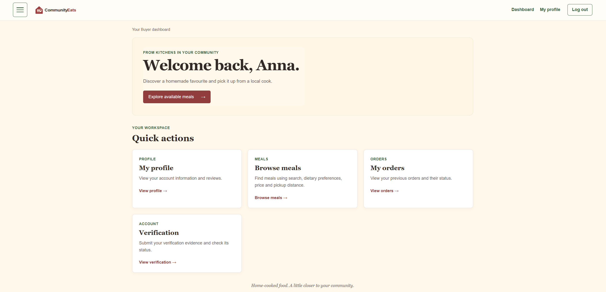
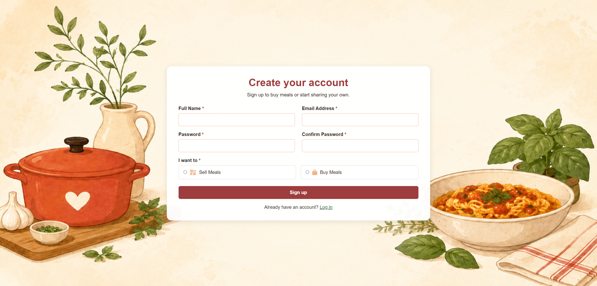
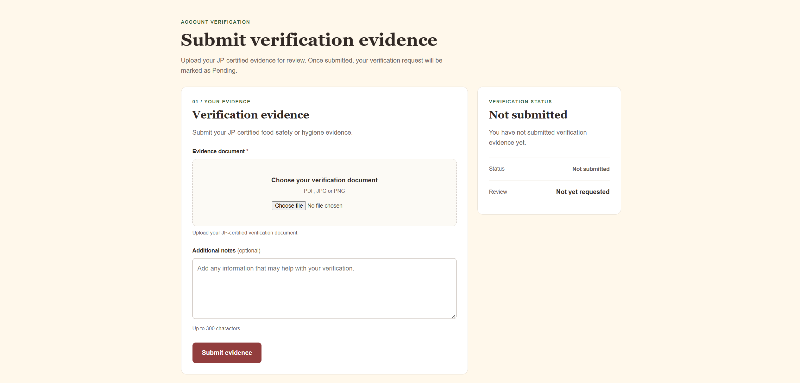
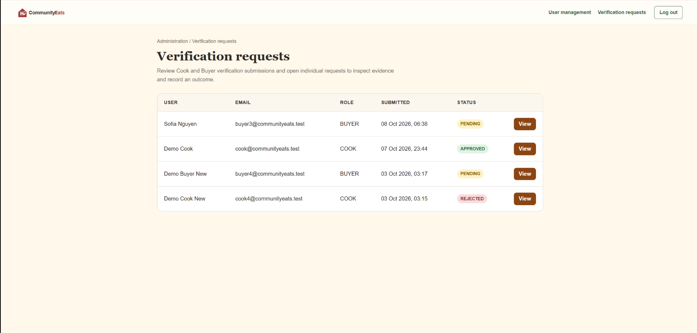
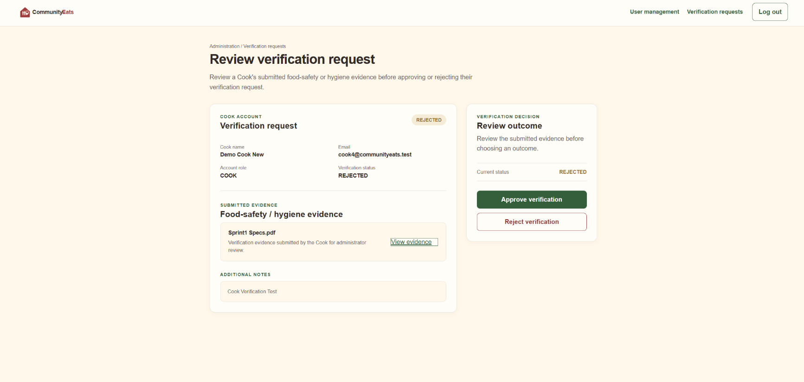

# CommunityEats 🍱

> Portfolio showcase for an RMIT Software Engineering team project.  
> The original source code is not included in this repository due to intellectual property restrictions.

CommunityEats is a web application designed to connect students looking for affordable meals with local home cooks.

I worked on this project as part of a university team using an Agile/Scrum workflow, contributing mainly to registration and verification features across Buyer, Cook and Admin roles.

---

## 👩‍💻 My Contributions

My main contributions included:

- Buyer and Cook registration flows
- Verification submission functionality
- Admin verification request management
- Approval and rejection workflows
- Testing and debugging
- Git-based collaboration using feature branches and pull requests

A lot of my work involved making sure different user flows connected properly — especially between users submitting verification evidence and admins reviewing those requests.

---

## 🛠️ Tech Stack

- Java
- Spring Boot
- Spring Security
- MySQL
- HTML / CSS
- Maven
- Docker
- Git & GitHub

---

## ✨ Features I Worked On

### Buyer & Cook Registration

Worked on registration flows for different user roles, supporting separate Buyer and Cook account experiences.

### Verification Submission

Developed verification submission functionality that allowed Buyers and Cooks to upload supporting evidence, add notes and track their current verification status.

### Admin Verification Management

Contributed to the admin workflow for viewing verification requests, reviewing submitted evidence and recording approval or rejection outcomes.

---

## 📸 Screenshots

### 1. Meal Discovery

*CommunityEats meal discovery interface, included to show the overall product and user experience.*

### 2. Role-Based Registration

*Registration flow supporting different account types within the platform.*

### 3. Verification Submission

*Verification submission flow for Buyers and Cooks to provide supporting evidence and track their status.*

### 4. Verification Request Management

*Admin interface for reviewing Buyer and Cook verification submissions, including request status and access to individual reviews.*

### 5. Admin Verification Review

*Detailed review screen for inspecting verification evidence and recording an approval or rejection outcome.*

---

## 🧪 Testing & Development

Testing and integration were a regular part of the project.

This included:

- Unit and integration testing
- Maven-based test execution
- Pull request reviews
- Feature branches
- Debugging and regression testing
- Collaborative development using GitHub Projects

Working in a shared codebase meant I had to think beyond just whether my own feature worked — I also had to make sure changes integrated properly with the rest of the system.

---

## 🎯 What I Learned

CommunityEats gave me more experience working on a larger team codebase where different features, roles and workflows all needed to connect properly.

It strengthened my understanding of:

- Spring Boot application structure
- Role-based authentication and authorisation
- Database-backed workflows
- Testing and debugging
- Working with changing requirements
- Collaborative Git workflows
- Agile/Scrum development

The biggest thing I took away from the project was becoming more comfortable working with code written by other people and building features that had to fit into an existing system.

---

## 📌 Project Context

CommunityEats was completed as part of **Software Engineering: Process and Tools (COSC2299)** at **RMIT University**.

This repository is intended as a portfolio showcase of the project and my individual contributions. The original source code is not publicly included because the project contains intellectual property belonging to multiple parties.

For a deeper look at the project, development process and what I learned, see the [Project Overview](docs/project-overview.md).